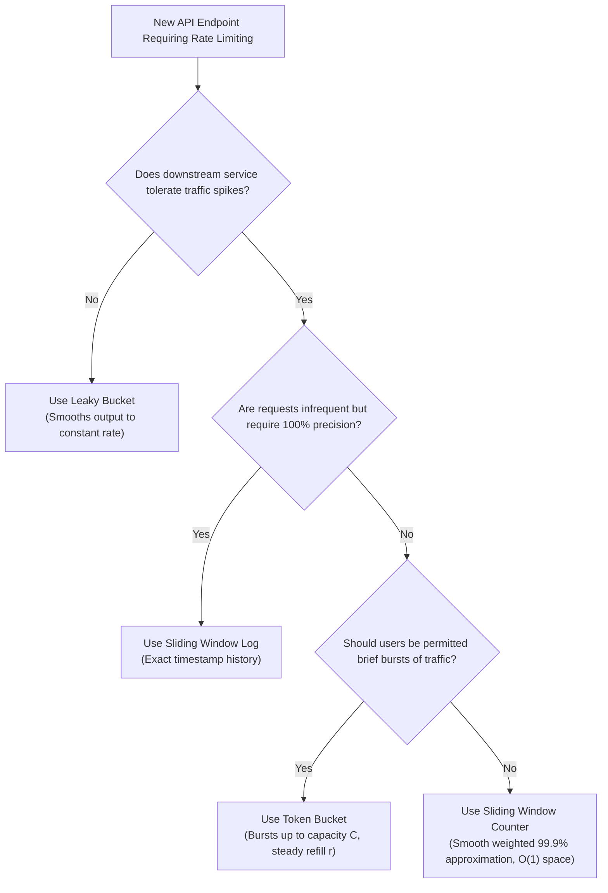

# 02. Rate Limiting Algorithms Deep Dive

Rate limiting is a foundational traffic-shaping mechanism used to protect APIs from denial-of-service (DoS) attacks, brute-force attacks, scraping, and cascading downstream system outages.

This document breaks down the **five foundational rate-limiting algorithms** implemented in this project across both C++ and Node.js engines.

---

## 1. Fixed Window Counter

### Mathematical Formulation & Concept
Time is partitioned into discrete, non-overlapping windows of duration $T$ (e.g., 10 seconds). For any timestamp $t_{\text{now}}$, the current window index is defined as:

$$W_i = \left\lfloor \frac{t_{\text{now}}}{T} \right\rfloor$$

A counter tracks requests within window $W_i$. When $t_{\text{now}}$ advances to a new window $W_{i+1}$, the counter resets to 0.

### The Window Boundary Flaw (2x Burst Vulnerability)
While computationally trivial ($O(1)$ time and memory), Fixed Window is vulnerable to **traffic bursts at window boundaries**:

```
Window W_0 (12:00:00 - 12:00:10)          Window W_1 (12:00:10 - 12:00:20)
[ . . . . . . . . . . [X X X X X] ]      [ [X X X X X] . . . . . . . . . . ]
                      ^                  ^
                 5 requests         5 requests
               at 12:00:09.9      at 12:00:10.1
-----------------------------------------------------------------------------
              A 1-second burst serves 10 requests (2x limit)!
```

If limit $M = 5$, a client can issue 5 requests at the end of $W_0$ and 5 requests at the start of $W_1$, resulting in $2M$ requests being accepted in a window of size $T$.

* **Time Complexity**: $O(1)$
* **Space Complexity**: $O(1)$ per client
* **Best Used For**: Coarse quotas (e.g., daily or hourly account caps).

---

## 2. Sliding Window Log

### Mathematical Formulation & Concept
Instead of maintaining a single counter, the Sliding Window Log maintains an explicit sorted collection of timestamps (Redis `ZSET` or in-memory `std::deque`) for each client:

$$\mathcal{L} = \{ t_1, t_2, \dots, t_k \}$$

When a new request arrives at $t_{\text{now}}$:
1. **Purge Expired Timestamps**:
   $$\forall t_i \in \mathcal{L} \quad \text{such that} \quad t_i \le t_{\text{now}} - T \implies \mathcal{L} \leftarrow \mathcal{L} \setminus \{ t_i \}$$
2. **Quota Check**:
   $$\text{if } |\mathcal{L}| < M \implies \mathcal{L} \leftarrow \mathcal{L} \cup \{ t_{\text{now}} \} \quad (\text{Allow}), \quad \text{else Reject}$$

### Advantages & Trade-Offs
* **Precision**: 100% exact. Eliminates window boundary burst anomalies completely.
* **Memory Overhead**: Extremely high under heavy traffic. If an API allows 1,000 requests per minute per user, Redis must store 1,000 64-bit integer timestamps for every active user ($O(N)$ space complexity).

* **Time Complexity**: $O(\log N)$ for sorted insertion and range deletion
* **Space Complexity**: $O(N)$ where $N$ is the number of requests per window
* **Best Used For**: High-value, security-sensitive endpoints (e.g., payment gateways, login attempts).

---

## 3. Sliding Window Counter

### Mathematical Formulation & Concept
A hybrid approach blending the $O(1)$ memory efficiency of Fixed Window with the boundary smoothing of Sliding Window Log.

Instead of storing individual timestamps, it tracks two values: the request count of the previous window ($\text{Count}_{\text{prev}}$) and the current window ($\text{Count}_{\text{curr}}$). The estimated request count at offset $t_{\text{elapsed}}$ into current window of size $T$ is computed as:

$$\text{Weight}_{\text{prev}} = 1 - \frac{t_{\text{elapsed}}}{T}$$

$$\text{Estimated Count} = \left( \text{Count}_{\text{prev}} \times \text{Weight}_{\text{prev}} \right) + \text{Count}_{\text{curr}}$$

```
[       Previous Window (Count = 10)       ] [       Current Window (Count = 2)        ]
                                              |<- 30% elapsed ->|
                                                 ^ Request arrives here!
Estimated Count = (10 * (1 - 0.30)) + 2 = 7 + 2 = 9 requests
```

If $\text{Estimated Count} + 1 \le M$, the request is permitted and $\text{Count}_{\text{curr}}$ is incremented.

* **Time Complexity**: $O(1)$
* **Space Complexity**: $O(1)$
* **Accuracy**: ~99.9% smooth approximation; eliminates 99% of boundary spikes with negligible memory.
* **Best Used For**: High-throughput public web APIs (Cloudflare uses this model widely).

---

## 4. Token Bucket

### Mathematical Formulation & Concept
A bucket has a fixed capacity $C$ and continuously refills with tokens at a rate of $r$ tokens per second.

Rather than running a costly background timer daemon, tokens are computed **lazily on demand** when a request arrives at $t_{\text{now}}$:

$$\Delta t = t_{\text{now}} - t_{\text{last\_refill}}$$

$$\text{tokens}_{\text{current}} = \min\left(C, \; \text{tokens}_{\text{prev}} + \Delta t \times r\right)$$

Each incoming request attempts to consume 1 token:
- If $\text{tokens}_{\text{current}} \ge 1$: $\text{tokens} \leftarrow \text{tokens}_{\text{current}} - 1$, request permitted.
- If $\text{tokens}_{\text{current}} < 1$: request throttled (`429 Too Many Requests`).

```
                +---------------------+
                | Token Refill (r/sec)|
                +----------+----------+
                           |
                           v
                     \           /
                      \ [T] [T] /    <--- Bucket Capacity C
                       \ [T]   /
                        \_____/
                           | (Consume 1 token per request)
                           v
                       [Request]
```

### Burst Handling Capabilities
* **Allows Bursts**: If an API is idle, tokens accumulate up to $C$. A client can immediately fire a sudden burst of $C$ requests with zero delay.
* **Enforces Long-Term Rate**: Sustained throughput is strictly bounded by $r$ tokens/sec.

* **Time Complexity**: $O(1)$
* **Space Complexity**: $O(1)$
* **Best Used For**: User-facing APIs and developer platforms (AWS, Stripe, GitHub).

---

## 5. Leaky Bucket

### Mathematical Formulation & Concept
Requests enter a buffer (bucket) of maximum capacity $B$ and drain (are processed) at a strictly constant leak rate $r$ units/sec.

Using the lazy-drain calculation:

$$\Delta t = t_{\text{now}} - t_{\text{last\_leak}}$$

$$\text{water}_{\text{current}} = \max\left(0.0, \; \text{water}_{\text{prev}} - \Delta t \times r\right)$$

If $\text{water}_{\text{current}} + 1 \le B$:
- The request enters the bucket: $\text{water} \leftarrow \text{water}_{\text{current}} + 1$, permitted.
- If $\text{water}_{\text{current}} + 1 > B$: bucket overflows, request dropped.

```
                     Incoming Requests (Bursty)
                             | | | | |
                             v v v v v
                        +-------------+
                        | \         / |
                        |  \ [Req] /  |  <--- Buffer Capacity B
                        |   \[Req]/   |
                        +------+------+
                               |
                               | (Constant Leak Rate r)
                               v
                     Steady, Uniform Outflow
```

### Contrast: Token Bucket vs. Leaky Bucket
* **Token Bucket** permits **bursty traffic** up to capacity $C$ at full wire speed.
* **Leaky Bucket** completely **flattens and smooths out traffic**, preventing sudden load spikes from ever reaching sensitive downstream databases or message brokers.

* **Time Complexity**: $O(1)$
* **Space Complexity**: $O(1)$
* **Best Used For**: Downstream message queuing, database write buffers, background job pipelines.

---

## 6. Master Algorithm Comparison Matrix

| Algorithm | Burst Handling | Memory Overhead | Precision | CPU Cost | Ideal Production Use Case |
| :--- | :--- | :--- | :--- | :--- | :--- |
| **Fixed Window Counter** | Poor ($2\times$ burst at boundaries) | $O(1)$ | Low | Minimal | Daily/monthly tier caps |
| **Sliding Window Log** | Smooth (No boundary spikes) | $O(N)$ (High) | 100% Exact | Medium | High-security financial APIs |
| **Sliding Window Counter** | Very Good (Weighted approximation) | $O(1)$ | ~99.9% | Minimal | High-throughput web gateways |
| **Token Bucket** | Excellent (Bursts allowed up to $C$) | $O(1)$ | High | Minimal | Consumer APIs, SaaS developer tiers |
| **Leaky Bucket** | Strictly buffers/drops bursts | $O(1)$ | High | Minimal | Database ingestion, egress smoothing |

---

## 7. Algorithm Selection Flowchart


